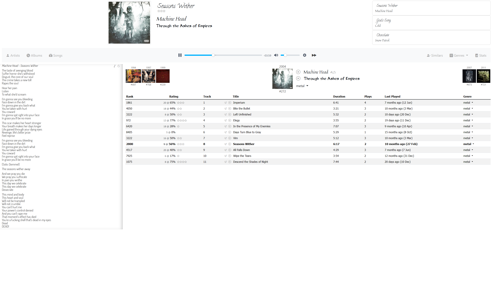
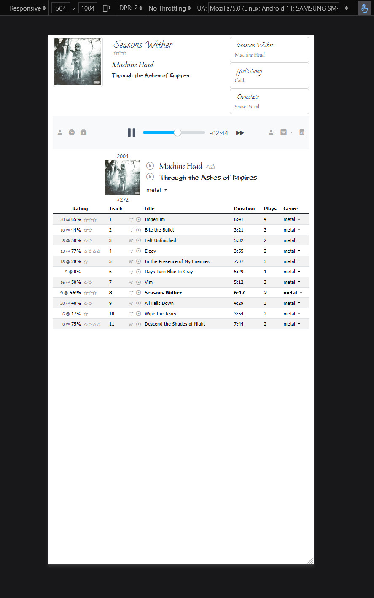
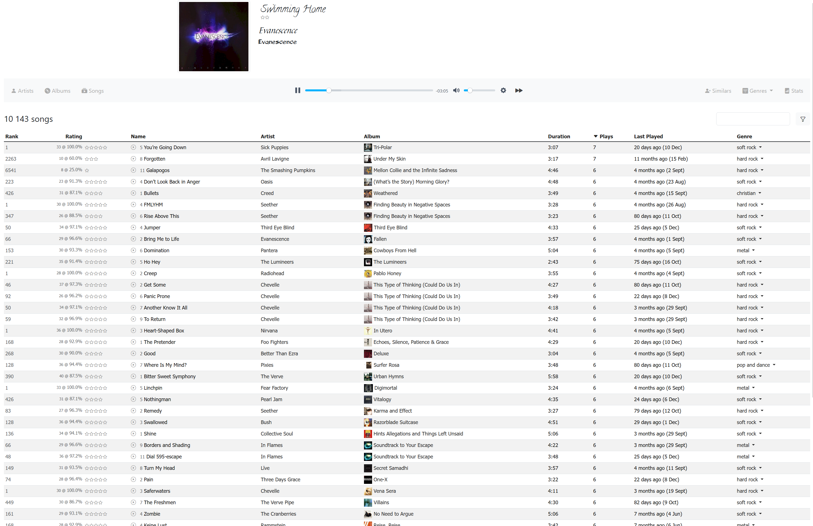
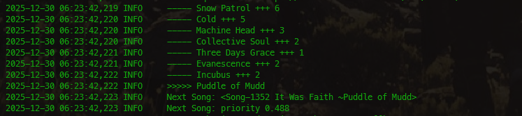
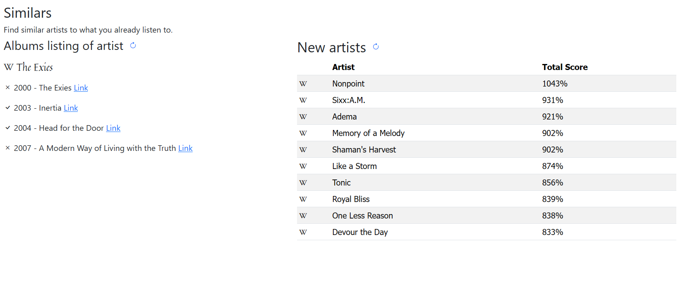

# speler2

music library player




## Why?

Because streaming services sucks. You should own what you pay for. Paying for a service is a waste
of money, like insurance.

This is an album-based player, where the UI is optimized for browsing full albums.


## Features
Nice app-like interface using HTMX.

Supports MP3 and FLAC files (toggle each format via `USE_MP3` / `USE_FLAC` in `.env`).

Automatically fetches lyrics for each song.

If you set it to listen on 0.0.0.0, then you can access it from other devices in your
network, e.g. your phone, since it is optimized for phone screens.



#### Best feature



When playing, there are ratings in the top right corner for the past few songs played. This allows
the songs to be rated. This app does not really support playlists, but you can filter by artist or
genre. This is a continuous player, so it picks the next song based on priority, based on the rating
of the songs and how recently it was played. This way, songs you like are played more often. Also,
it tries to avoid repeating the same artist within an hour. You can see in the log that it waits for
a little time to pass before repeating the same artist (showing how many is still in the queue).

A song's rating is its win ratio in those matches. A match song removed from the library before
you click is skipped (and named in the rating box); the others are still rated. Albums and artists use a bayesian average so one
great single can't top the list: an album averages its songs, filled up to 10 with the library's
mean song rating; an artist averages its albums, filled up to 3 with the mean album rating.




#### Last.fm scrobbler integration

Optionally, you can set the last.fm values in the .env file, and it will scrobble the songs you play
```ini
LASTFM_API_KEY=
LASTFM_SECRET=
```

If you use that, the Similars page also recommends a song you don't own yet:



Each visit shows the stored pick, then asks last.fm `track.getSimilar` (top 50) about one more song
(most played, then rating, then artist rating) and keeps its best 10 tracks you don't own. Score
sums `rating × match` over the songs recommending it (top 10 by match listed), so can pass 100%.
"Last updated" at the bottom is the latest fetch (newest `Song.similars_at`).
Last.fm matches titles literally (curly `’` fails where `'` works); unknown tracks are `WSError` `'6'`.
pylast fixes its timeout (5s connect, 10s read), so this fetch retries network errors 3×; scrobbles don't.

It also checks wikipedia for artist info if you have missed an album (beta), and lists the lowest
rated albums as removal candidates (8, one ratings window of slots). An album is struck through while
any song on it has fewer than 3 plays or 15 ratings (not had a fair chance yet; 5 ratings per play).
Those songs get +1 play priority, so the list clears quickly; it is re-read every 30 minutes.


## How to use

Just clone the repo and do normal django setup steps. You can use uv to set it up quickly:

```bash
uv sync
```

Copy your .env from .env.dist and set your values, e.g.
```ini
MUSIC_DIR=C:\Users\jacoj\Dropbox\Jaco\Music
```

Then just run it to scan for music file changes:
```bash
python manage.py parsemusic
```

Songs, albums and artists store their stats (counts, plays, ratings). Deleting a rating, play, song
or album, or `parsemusic recheck` moving a song, marks the rows it leaves behind dirty: recalculate
them with `python manage.py cleanstats`, or every row with `--all` (~40s for 9k songs).

Then run the server: `python manage.py runserver 0.0.0.0:8888` (my `.bashrc` has a `speel` function
that cds into the repo, activates `.venv` and runs exactly that).

## Tech

Django with HTMX. Previous version used React, but that is obsolete thanks to HTMX.
Contribute: do whatever you want.
